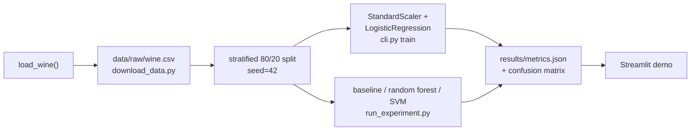
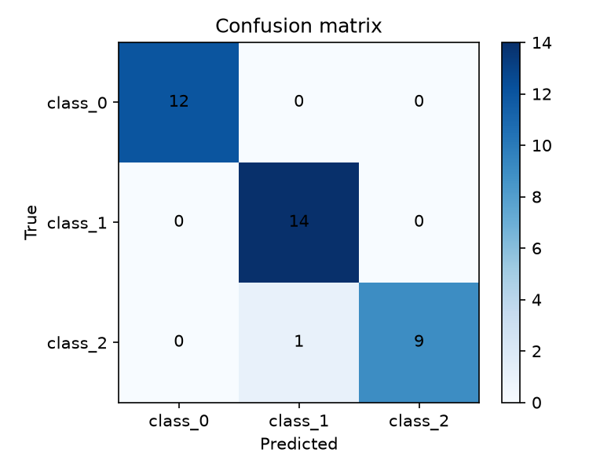

# 🍷 wine-origin-classifier

Predicts which of 3 grape cultivars a wine came from, using 13 chemical measurements — a small, complete, fully-reproducible example project built from [`ucu-ai-course/project-template`](https://github.com/ucu-ai-course/project-template).


> [!note]
> This repo is **both** a GitHub Template (click "Use this template" to get a clean, working starting point for your own semester project) **and** a fully filled-in example (this exact repo trains a real model and produces real numbers — nothing here is a placeholder). See §"Repository structure" for what to replace with your own project's content.

## Demo

`uv run streamlit run app/streamlit_app.py` (see [`app/README.md`](app/README.md)) launches the demo below: enter 13 chemical measurements (or click "fill with a random test-set sample"), get a predicted cultivar and class probabilities.


## Team

| Name              | GitHub                                                   | Role                                |
| ----------------- | -------------------------------------------------------- | ----------------------------------- |
| Oleksandr Kosovan | [@OleksandrKosovan](https://github.com/OleksandrKosovan) | Data pipeline, modeling, evaluation |
| Slavko Prytula    | [@SlavkoPrytula](https://github.com/SlavkoPrytula)       | CLI, Streamlit app, CI/CD           |

## Problem and motivation

Wine composition is routinely measured in a lab (alcohol content, phenols, color intensity, and so on), but the cultivar a bottle actually comes from isn't always recorded reliably further down the supply chain. This project asks a narrow, checkable question: given only the chemistry, can a simple model recover the cultivar? It's a deliberately small, well-understood problem — the point of this repository is to demonstrate a complete, reproducible ML project structure end to end, not to push the state of the art on wine chemistry.

## Data

178 samples, 13 numeric chemical features, 3 balanced-ish classes, sourced from the UCI Wine Recognition dataset via `sklearn.datasets.load_wine`. No missing values, no personal data, no licensing restrictions beyond standard academic citation. Full data card, schema, and checksum: [`data/README.md`](data/README.md).

> [!note] Why this matters: data isn't part of this git repo
> `data/`, like `models/`, is gitignored. Committing raw data bloats the repo forever (`git rm` doesn't remove history — see `data/README.md`), makes diffs unreadable, and often runs into licenses that don't actually permit redistribution. Instead, `data/raw/CHECKSUMS.txt` **is** committed — a few bytes that let anyone verify they regenerated the exact same data, without the data itself ever touching git.

## Approach



Baseline (`DummyClassifier`) → primary model (`StandardScaler` + `LogisticRegression`) → comparison model (`RandomForestClassifier`) → a fourth model we tried and rejected (`SVC`, default hyperparameters). See [`results/experiments.md`](results/experiments.md) for the full comparison, including the rejected run.

## Results

Test set (36 held-out samples) and 5-fold cross-validation, seed=42. Generated by `python scripts/run_experiment.py` on 2026-08-09; reproduce with `make reproduce` (prints the primary model's numbers) or `uv run python scripts/run_experiment.py` (full table below).

| Model                                     | Test accuracy | Test macro-F1 | CV accuracy (mean ± std) |
| ----------------------------------------- | ------------- | ------------- | ------------------------ |
| Baseline (most-frequent class)            | 0.389         | 0.187         | 0.399 ± 0.015            |
| **Logistic regression (selected)**        | 0.972         | 0.971         | **0.983 ± 0.014**        |
| Random forest (200 trees)                 | 1.000         | 1.000         | 0.978 ± 0.021            |
| SVM, default hyperparameters — *rejected* | 0.694         | 0.558         | 0.674 ± 0.040            |



> [!note] Why this matters: a metric without a baseline row means nothing
> "97% accuracy" sounds great until you notice the majority class alone is ~40% of the test set — at which point 97% is either impressive or barely-better-than-guessing, and you can't tell which without the baseline row above. Report it every time, not just when it's flattering.

> [!note] Why this matters: one seed isn't a conclusion
> Look at the table above: random forest scores *higher* on the single test split (1.000 vs 0.972) than logistic regression — but logistic regression wins on 5-fold CV, both on the mean **and** with a lower std. With only 36 test samples, one flipped prediction moves accuracy by ~2.8 points — enough to flip a ranking that a single split would have gotten wrong. That's why we selected the model on CV numbers, not the test-set numbers. Full writeup: [`results/experiments.md`](results/experiments.md).

## Quick start

Install [uv](https://docs.astral.sh/uv/getting-started/installation/) 0.13.0 or newer first, then run:

```bash
git clone <repo-url> && cd wine-origin-classifier
uv python install 3.14
uv sync                             # creates .venv and installs runtime and dev dependencies
uv run pre-commit install            # installs the existing Git hooks
make reproduce                      # data -> train -> evaluate; should print accuracy=0.9722 macro_f1=0.9710
uv run streamlit run app/streamlit_app.py  # opens the demo at localhost:8501
```

> [!important]
> Python 3.14 is required by `.python-version` and `pyproject.toml`. `make setup` runs the same Python installation, dependency sync, and hook installation commands shown above. Do not substitute an older Python version if a dependency fails to install.
>
> `setup` and `reproduce` are the only two `Makefile` targets — deliberately, as a small example of the pattern rather than a wrapper around everything. Every other command in this README (training, the demo, linting, tests) is run directly; see "Development" below.

### Dependency management

`pyproject.toml` is the source of truth for runtime dependencies and the `dev` dependency group. `uv.lock` records the resolved versions for reproducible installs; commit both files when dependencies change. `uv sync` includes development dependencies and installs the existing `wine_origin` package in editable mode. Use `uv run` for commands in the project environment.

```bash
uv add <package>                     # add a runtime dependency
uv add --dev <package>               # add a development dependency
uv lock --check                      # check that the lock matches pyproject.toml
uv sync --locked                     # install without changing the lock (also used in CI)
```

The existing flake8, Black, isort, and pre-commit checks remain in use. After changing dependencies, rerun the tests, hooks, and `make reproduce`.

Project tables use Polars. Streamlit still requires pandas as a transitive dependency; project code and notebooks do not import it.

## Repository structure

```
.
├── src/wine_origin/     # the package: config, data, models, evaluate, cli.py (the single entry point)
├── scripts/              # download_data.py, run_experiment.py
├── app/                  # streamlit_app.py — the interactive demo (see app/README.md)
├── notebooks/             # 01-04, executed, narrative-first (see notebooks/README.md)
├── tests/                 # test_data.py, test_models.py, test_reproducibility.py
├── config/default.yaml    # every hyperparameter, path, and the seed — nothing hardcoded in src/
├── data/                  # raw data NOT committed; data/README.md (data card) IS
├── models/                # trained weights NOT committed; models/README.md (HF Hub instructions) IS
├── results/               # metrics.json + experiments.md + figures/ — all committed, all small
├── docs/                  # proposal/, poster/, slides/, CONTRIBUTING.md, and this file's supporting docs
└── .github/workflows/     # lint.yml — one CI example, easy to extend (see its comments)
```

Everything above (except the placeholders in `docs/proposal|poster|slides/`) is real, executed, working content — clone it and run it, don't take our word for it.

## Reproducibility

- **Seed**: `42`, set once in `config/default.yaml`, applied via `wine_origin.utils.set_seed()` to both `random` and `numpy`.
- **Versions**: Python 3.14; dependency declarations are in `pyproject.toml` and exact resolved versions are in `uv.lock`. The committed results were generated on Python 3.13.14; reruns use the current project environment. Every run's exact versions + OS + git commit are captured by `wine_origin.utils.env_info()` and written into `results/metrics.json`'s `env` field — that's what "reproducible" is checked against, not just claimed.
- **OS tested on**: macOS (arm64) locally; `.github/workflows/lint.yml` also runs on Ubuntu (`ubuntu-latest`) on every push — add a `test.yml` alongside it the same way if you want CI to run `pytest` too, not just lint.
- **Runtime**: `make reproduce` takes well under a minute on a laptop — no GPU needed, no dataset download beyond what's bundled in scikit-learn.
- **Known limitations**: 178 samples total means wide uncertainty on any single metric — see the CV std columns in the results table, and treat any one number with the same caution `results/experiments.md` applies to the random-forest test-set score.

> [!note] Why this matters: a seed alone isn't reproducibility
> Fixing the seed makes a run *repeatable* on your own machine. It's `env_info()` — capturing exact library versions, OS, and the git commit — that makes it *reproducible* somewhere else, months later, when a library's default behavior has quietly changed underneath an unpinned dependency.

## Development

```bash
uv run flake8 src/ scripts/ tests/ app/ && uv run black --check src/ scripts/ tests/ app/ && uv run isort --check src/ scripts/ tests/ app/  # what CI runs
uv run black src/ scripts/ tests/ app/ && uv run isort src/ scripts/ tests/ app/  # auto-fix formatting
uv run pytest                         # full test suite
uv run ty check                       # type-check src/, scripts/, tests/, and app/
uv run pre-commit run --all-files      # existing hooks
uv run jupyter lab notebooks/          # open notebooks with the project kernel
```

Pre-commit hooks (installed by `make setup`) catch most of this before you even open a PR — see `.pre-commit-config.yaml`.

The ty hook checks all first-party Python code on every commit using the project's uv environment. Run `uv sync --locked` after dependency changes; the hook uses `--locked --no-sync` so it does not install dependencies or update `uv.lock`. CI also runs `uv run ty check`.

### Research notebooks

Use JupyterLab for research notebooks. Save them as `.ipynb` files in `notebooks/`
and use the project's Python 3.14 kernel and dependencies from `pyproject.toml`.
See `notebooks/00_jupyter_example.ipynb` for an interactive example and
`notebooks/README.md` for notebook conventions. Restart the kernel and run all
cells in order before delivering changes.

```bash
uv run jupyter lab notebooks/
uv run jupyter nbconvert --to notebook --execute --inplace notebooks/00_jupyter_example.ipynb
```

> [!note] Why this matters: CI enforces it instead of "we agreed to"
> "The team agreed to run black before committing" survives about one deadline-week skip before someone's code silently stops matching. A red `lint` check in CI is unambiguous, and — importantly — **a red CI check blocks merging**: reviewing a PR you can't tell has passed its own tests is a bad use of a reviewer's time, so don't merge over red CI, fix it first.

## AI usage

| Tool           | Used for                                                                                       | How the result was checked                                                                                            |
| -------------- | ---------------------------------------------------------------------------------------------- | --------------------------------------------------------------------------------------------------------------------- |
| GitHub Copilot | Autocomplete while writing `src/wine_origin/evaluate.py`                                       | Read line by line; covered by `tests/test_reproducibility.py` and `tests/test_models.py`                              |
| ChatGPT        | Explaining the difference between macro- and micro-averaged F1 before choosing which to report | Cross-checked against the scikit-learn docs for `f1_score`                                                            |
| Claude         | First draft of this README's prose                                                             | Rewritten by hand; every number was replaced with the actual value from `results/metrics.json`, not left as generated |

**What we didn't delegate:** the model-selection decision itself (§Results) — specifically, noticing that the single-split ranking disagreed with the cross-validated ranking, and choosing to trust CV — was made by reading the actual numbers, not accepted from a tool's suggestion. Any hyperparameter or architecture choice that ended up in `config/default.yaml` was verified by rerunning `python scripts/run_experiment.py` ourselves, not taken on faith.

## Contribution statement

| Member            | Contribution | Responsible for                                                                                  |
| ----------------- | ------------ | ------------------------------------------------------------------------------------------------ |
| Oleksandr Kosovan | 50%          | `src/wine_origin/` (data, models, evaluate), `scripts/run_experiment.py`, notebooks 01–03, tests |
| Slavko Prytula    | 50%          | `cli.py`, `app/streamlit_app.py`, CI workflow, `docs/`, notebook 04, this README                 |

Both members agree with the above distribution.

## License and citation

|                        | License                                              | Notes                                                                                |
| ---------------------- | ---------------------------------------------------- | ------------------------------------------------------------------------------------ |
| Code (this repo)       | MIT — see [`LICENSE`](LICENSE)                       | Free to reuse, including commercially                                                |
| Data                   | See [`data/README.md`](data/README.md)               | **Not MIT** — the dataset's own terms apply, independent of this repo's code license |
| Trained model          | Inherits the data's terms + this repo's code license | See [`models/README.md`](models/README.md)                                           |
| Text / poster / slides | CC BY 4.0 (recommended)                              | Attribute this repo if reused                                                        |

> [!important] Why this matters: MIT on the repo does not cover the data
> The single most common licensing mistake in student projects: assuming an MIT `LICENSE` file at the repo root means *everything* in the repo — including any data you collected or redistributed — is under that license. It doesn't. Code and data are licensed independently; check both.

Citing this project: see [`CITATION.cff`](CITATION.cff) (GitHub renders a "Cite this repository" button from it automatically). Citing the underlying dataset: see [`data/README.md`](data/README.md).

## Acknowledgments

Built from [`ucu-ai-course/project-template`](https://github.com/ucu-ai-course/project-template). Thanks to the course instructors and our project mentor for feedback throughout the semester.
